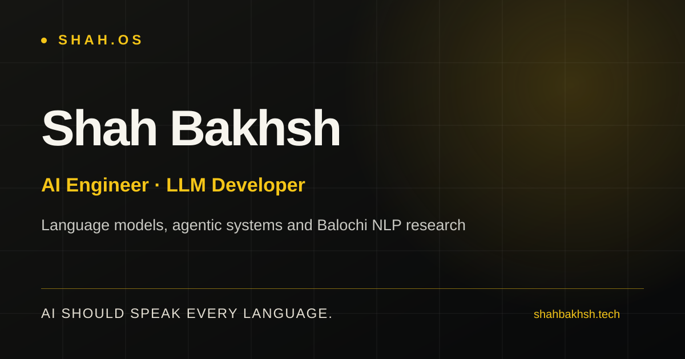

<div align="center">

# SHAH.OS

### AI should speak every language.

**The official portfolio of [Shah Bakhsh](https://shahbakhsh.tech)**  
*AI Engineer · LLM Developer · Balochi NLP Researcher*

A research-led, interactive portfolio at the intersection of **large language models, agentic AI, applied machine learning, and low-resource language technology**.

[**Explore Live Website**](https://shahbakhsh.tech) · [**Research Library**](https://shahbakhsh.tech/research/) · [**Projects**](https://shahbakhsh.tech/projects/) · [**Contact**](https://shahbakhsh.tech/contact/)

[](https://github.com/shah-bakhsh/shah-bakhsh-shah-os/actions/workflows/portfolio-checks.yml)




</div>

---

## Overview

**SHAH.OS** is my personal space to present engineering work, document research, and connect with people building useful AI systems.

Its central mission is simple: **AI should speak every language.** A major part of my work explores foundational tools for **Balochi**, a language that remains underrepresented in mainstream language technologies.

This repository contains the **portfolio website**, not the training code for every project it features. Individual research implementations, documentation, and evaluations live in their linked repositories.

## Explore the portfolio

| Page | What's inside |
| --- | --- |
| [Home](https://shahbakhsh.tech/) | Signature landing experience, selected work, animated research explorer, and interactive terminal |
| [Research](https://shahbakhsh.tech/research/) | Evidence-led Balochi NLP case studies and research directions |
| [Projects](https://shahbakhsh.tech/projects/) | Applied AI experiments, concepts, and open-source projects |
| [About](https://shahbakhsh.tech/about/) | Engineering focus, background, and language-technology mission |
| [Contact](https://shahbakhsh.tech/contact/) | Research, engineering, and collaboration enquiries |
| [Professional profiles](https://shahbakhsh.tech/links/) | Verified destination links provided for professional accounts |

## Featured research

These are **results reported in the linked project repositories**, not independent benchmarks performed by this portfolio. Evaluation datasets, baselines, and limitations vary by project.

| Research project | Focus | Documented result or status |
| --- | --- | --- |
| [BalBERT](https://github.com/shah-bakhsh/BalBERT) | Domain-adaptive XLM-RoBERTa language representations for Balochi | ~97.8% reduction in masked-language-model perplexity against the repository's stated baseline |
| [BalPOS](https://github.com/shah-bakhsh/BalPOS) | Part-of-speech tagging using 16 Universal Dependencies labels | 87.26% held-out accuracy (v2); 87.22% weighted F1 |
| [BalNER](https://github.com/shah-bakhsh/BalNER) | Balochi named-entity recognition | 0.7034 reported entity-level F1 on the documented test set |
| [BalTokenizer](https://github.com/shah-bakhsh/BalTokenizer) | Balochi-focused 48K Unigram tokenisation | 99.9% reported character coverage and 0.0% unknown-token rate on the evaluated text |
| [BalNLP](https://github.com/shah-bakhsh/BalNLP) | Python, FastAPI, and right-to-left language tooling | Four components locally integration-checked; not a model-accuracy claim |
| BalOCR | Balochi optical character recognition | Research in progress; no published model-quality metric claimed |

**Read the case studies:** [BalBERT](https://shahbakhsh.tech/research/balbert/) · [BalPOS](https://shahbakhsh.tech/research/balpos/) · [BalNER](https://shahbakhsh.tech/research/balner/) · [BalTokenizer](https://shahbakhsh.tech/research/baltokenizer/) · [BalNLP](https://shahbakhsh.tech/research/balnlp/) · [BalOCR](https://shahbakhsh.tech/research/balocr/)

### Selected applied AI projects

- **[CrisisPilot AI](https://github.com/shah-bakhsh/CrisisPilot-AI)** — multi-agent emergency intelligence and coordination concept.
- **[PathPilot AI](https://github.com/shah-bakhsh/pathpilot-ai)** — AI-assisted career navigation concept.
- **[ReelForge](https://github.com/shah-bakhsh/reelforge)** — experimental, local-first speech and computer-vision media workflows.

These are presented according to their documented maturity; an experiment or concept is not represented as a production service.

## Website experience

- **Distinctive visual identity** — dark editorial design, gold accents, responsive layouts, and thoughtful interactions.
- **Interactive command terminal** — explore the website through commands such as `help`, `about`, `skills`, `research`, `projects`, `balochi-ai`, and `contact`.
- **Research explorer** — discover Balochi NLP initiatives and their documented outcomes.
- **Dedicated case studies** — learn about the research problem, methodology, technical stack, results, and limitations.
- **Accessible interactions** — semantic landmarks, keyboard navigation, focus management, and reduced-motion preferences.
- **Search-ready foundation** — page-specific metadata, canonical URLs, structured identity data, `robots.txt`, and a generated XML sitemap.

## Technology stack

| Area | Technologies |
| --- | --- |
| Framework | Next.js 15 (App Router, static export) |
| Language | TypeScript |
| UI | React 19, Tailwind CSS v4 |
| Motion | Motion for React |
| Components & icons | Radix Slot, class-variance-authority, Lucide |
| Code quality | ESLint, TypeScript checks, GitHub Actions |
| Deployment | Vercel, connected to the `main` branch |

## Getting started

### Prerequisites

- **Node.js 20 or later** (a supported current LTS release is recommended)
- **npm**
- **Git**

### Local development

```bash
git clone https://github.com/shah-bakhsh/shah-bakhsh-shah-os.git
cd shah-bakhsh-shah-os
npm install
npm run dev
```

Visit **http://localhost:3000** to explore the local website.

### Quality checks

```bash
npm run typecheck
npm run lint
npm run build
```

The production build uses Next.js static export and writes deployable files to **`out/`**.

### Project structure

```text
app/
  page.tsx                  # Interactive homepage
  about/                    # Professional biography
  projects/                 # Applied AI showcase
  research/
    page.tsx                # Research index
    [slug]/page.tsx         # Research case studies
  contact/                  # Collaboration information
  links/                    # Professional profile links
  layout.tsx                # Site metadata and identity schema
  sitemap.ts                # Generated XML sitemap
  robots.ts                 # Crawler directives
components/                 # Shared UI and portfolio shell
lib/portfolio.ts            # Curated case study and project data
public/                     # Brand and static assets
.github/workflows/
  portfolio-checks.yml      # Automated checks
next.config.ts              # Static export configuration
```

## Deployment and search

The production site is hosted on **Vercel**:

**[shahbakhsh.tech](https://shahbakhsh.tech)**

The repository's `main` branch is connected to the Vercel project for deployment. The public domain and DNS are managed separately from this repository.

- [XML sitemap](https://shahbakhsh.tech/sitemap.xml)
- [Robots directives](https://shahbakhsh.tech/robots.txt)

> **Search visibility note:** SEO metadata and structured data help search engines understand the site. They do not guarantee indexing, prominent rankings, or the appearance of third-party profiles in search results.

## Collaboration

I'm interested in collaborations involving **low-resource NLP, language-model adaptation, agentic systems, AI tooling, and practical developer workflows**.

If you're exploring related problems, I'd be glad to connect.

**Email:** [shahbakhshtech@gmail.com](mailto:shahbakhshtech@gmail.com)  
**LinkedIn:** [Shah Bakhsh](https://www.linkedin.com/in/shah-bakhsh/)  
**GitHub:** [@shah-bakhsh](https://github.com/shah-bakhsh)  
**Hugging Face:** [shah-bakhsh](https://huggingface.co/shah-bakhsh)

## Contributing and usage

Suggestions and constructive feedback are welcome through **[GitHub Issues](https://github.com/shah-bakhsh/shah-bakhsh-shah-os/issues)**. For substantial changes, consider opening an issue to discuss the proposal first.

**License:** No license is declared in this repository. Unless a license is added, the code should not be assumed to be open-source licensed merely because the repository is public. Research repositories may have their own separate terms.

---

<div align="center">

**Built by [Shah Bakhsh](https://shahbakhsh.tech).**  
*Building toward AI that serves more languages and more people.*

[Website](https://shahbakhsh.tech) · [Research](https://shahbakhsh.tech/research/) · [GitHub](https://github.com/shah-bakhsh) · [LinkedIn](https://www.linkedin.com/in/shah-bakhsh/)

</div>
